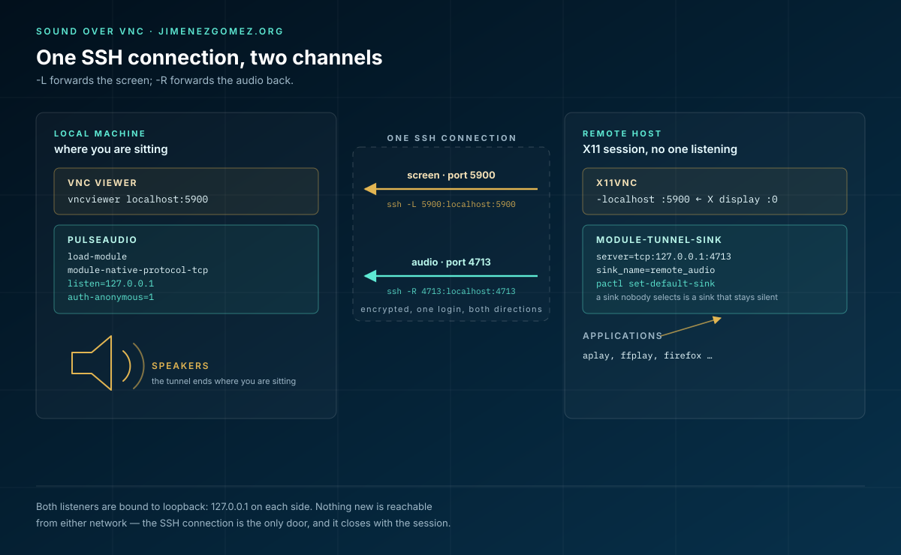

VNC has no sound. This is not a bug, a missing plugin, or a configuration you have
failed to find: **the RFB protocol has no audio channel at all**. It carries a
rectangle of pixels in one direction and keyboard and mouse events in the other,
and that is the whole contract. Anything that sounds like "enable audio in VNC"
is either a different protocol wearing the same name, or a second connection
doing the work quietly.

Once you accept that, the problem becomes much easier — and much smaller. You do
not need to replace VNC with RDP or SPICE, and you do not need a proprietary
remote-desktop stack. You need to add **one extra channel** to the transport you
are already using: the SSH connection that is forwarding your VNC port.

This article is that channel, in a single script, with the reasoning behind each
line — including the five things that were wrong with the version I started
from.

## The shape of the problem

A VNC session between two Linux machines usually looks like this:

- the remote host runs `x11vnc` (or `tigervnc`, or `x0vncserver`) against an X
  display, listening on port `5900`;
- you open an SSH connection that forwards `5900` to your machine;
- a viewer connects to `localhost:5900`.

The audio, meanwhile, lives somewhere else entirely. On the remote host there is
a PulseAudio server (or a PipeWire server speaking the PulseAudio protocol) with
one or more sinks. When the machine even has a sound card, the audio goes there
— to speakers nobody is sitting in front of. When it does not (a headless box, a
container, a VM), the sink is a dummy and the sound goes nowhere.

PulseAudio, however, has a feature that solves this exactly: **network sinks**.
You can create, on the remote machine, a sink that looks and behaves like a
local output device but actually ships its samples to another PulseAudio server
over TCP. That is `module-tunnel-sink`.

So the plan is:

1. On **your** machine, open a PulseAudio TCP port — bound to loopback only.
2. On the **remote** machine, create a tunnel sink pointing at that port.
   Because "that port" is on your machine, the remote needs a **reverse** path to
   it: `ssh -R`.
3. Make that tunnel sink the default sink on the remote, so applications actually
   use it.
4. Start `x11vnc` as usual.

One SSH connection, two forwarded ports: `-L` for the screen, `-R` for the sound.



## Requirements

- **Local machine**: PulseAudio or PipeWire with `pipewire-pulse` (so `pactl`
  works), plus `ssh`. Any distribution.
- **Remote machine**: an **X11** session (not Wayland — `x11vnc` mirrors an X
  display), `x11vnc`, and `pactl` working *for the same user* that owns the
  session.
- On the remote side, `pactl` over SSH sometimes needs the runtime directory
  explicitly. If `pactl info` fails there, try
  `XDG_RUNTIME_DIR=/run/user/$(id -u) pactl info`; if it works, export it in the
  script's remote section.
- No audio server needs to be listening on the remote's network, and no VNC
  password is needed if — as below — `x11vnc` binds to loopback only.

## The script

```bash
#!/usr/bin/env bash
# vnc-sound-host.sh — run a VNC server on a remote X display
#                    and bring its audio back to this machine.
#
# Usage: vnc-sound-host.sh [user@]REMOTE_HOST
set -euo pipefail

REMOTE_HOST="${1:?usage: $(basename "$0") [user@]REMOTE_HOST}"

VNC_PORT="${VNC_PORT:-5900}"     # local port for the VNC viewer
PULSE_PORT="${PULSE_PORT:-4713}" # TCP port used on both ends for audio
SINK_NAME="${SINK_NAME:-remote_audio}"
SINK_DESC="${SINK_DESC:-Remote desktop audio}"

log() { printf '  -> %s\n' "$*"; }

# --- remote side: remove tunnel sinks left over from previous runs ----------
remote_unload() {
  ssh "$REMOTE_HOST" bash -s -- "$SINK_NAME" <<'REMOTE' || true
set -u
sink=$1
for m in $(pactl list short modules |
           awk -v s="sink_name=$sink" '$2 == "module-tunnel-sink" && index($0, s) { print $1 }'); do
  pactl unload-module "$m"
done
REMOTE
}

# --- local side: close the audio port again, whatever happens ---------------
cleanup() {
  pactl unload-module module-native-protocol-tcp 2>/dev/null || true
  remote_unload
}
trap cleanup EXIT

# 1. Local PulseAudio: accept native-protocol clients, loopback only,
#    anonymous (the SSH tunnel is the authentication).
pactl unload-module module-native-protocol-tcp 2>/dev/null || true
pactl load-module module-native-protocol-tcp \
      listen=127.0.0.1 port="$PULSE_PORT" auth-anonymous=1 >/dev/null
log "local PulseAudio listening on 127.0.0.1:$PULSE_PORT"

# 2. Do not stack sinks if the script was interrupted last time.
remote_unload

# 3. One SSH session: -L for the screen, -R for the sound.
#    ssh joins its arguments with spaces before the remote shell sees them, so
#    values that may contain spaces have to be quoted: %q does exactly that.
remote_cmd=$(printf 'bash -s -- %q %q %q' "$PULSE_PORT" "$SINK_NAME" "$SINK_DESC")

ssh "$REMOTE_HOST" \
    -o ExitOnForwardFailure=yes \
    -L "$VNC_PORT:localhost:5900" \
    -R "127.0.0.1:$PULSE_PORT:127.0.0.1:$PULSE_PORT" \
    "$remote_cmd" <<'REMOTE'
set -euo pipefail
pulse_port=$1 sink_name=$2 sink_desc=$3

# A sink that behaves like a sound card but ships to our machine.
pactl load-module module-tunnel-sink \
      server="tcp:127.0.0.1:$pulse_port" \
      sink_name="$sink_name" \
      format=s16le rate=48000 channels=2 \
      sink_properties="device.description=$sink_desc" >/dev/null

# A sink nobody uses is a sink that produces no sound.
pactl set-default-sink "$sink_name"

# Restart the server cleanly; -localhost keeps it off the remote network.
pkill -x x11vnc 2>/dev/null || true
exec x11vnc -display "${DISPLAY:-:0}" -localhost -forever -shared -noxdamage
REMOTE
```

That is the whole thing. Two details are easy to miss on a first reading.
`-o ExitOnForwardFailure=yes` turns "the port was already taken, I will carry on
anyway" into a clean failure instead of a session that connects and then behaves
mysteriously. And the remote command is built with `printf '%q'` because **ssh
joins its arguments with single spaces** before handing them to the remote shell:
a description like `Remote desktop audio` would arrive as three separate words.
Everything else in this article is about why each line is there.

## What was wrong with the first version

The script I started from looked like this:

```bash
[[ $# -lt 1 ]] && echo "Usage: $0 REMOTE_HOST" && exit -1

pactl unload-module module-native-protocol-tcp ; pactl load-module module-native-protocol-tcp

REMOTE_HOST=$1

ssh $REMOTE_HOST -L 5900:localhost:5900 "pactl load-module module-tunnel-sink   server=tcp:$REMOTE_HOST sink_name=remote_$REMOTE_HOSt sink_properties=device.description='SndOutput→$REMOTE_HOST' ; killall x11vnc ; x11vnc"
```

It is close, and it shows the right instinct — but it cannot work. Five reasons:

**1. The tunnel sink points at the wrong machine.** `server=tcp:$REMOTE_HOST`
makes the *remote* PulseAudio connect to *itself* on port `4713`. But the port
was opened on the local machine, and nothing forwards `4713` from the remote back
to us. The connection is refused (or, worse, lands on something else). The sink
has to be `server=tcp:127.0.0.1:4713` reached through a **reverse** forward:
`-R 4713:localhost:4713`.

**2. `auth-anonymous=1` and `listen=127.0.0.1` are both missing.** With the
defaults, `module-native-protocol-tcp` listens on every interface and expects
the cookie in `~/.config/pulse/cookie`. The remote machine does not have *your*
cookie, so authentication fails; and while it fails, you have a PulseAudio port
open to the whole local network. Loopback plus anonymous *inside an SSH tunnel*
is the right combination: no password to share, nothing exposed.

**3. Nothing becomes the default sink.** `module-tunnel-sink` creates a sink; it
does not select it. Applications keep playing into the old default and the
tunnel stays silent. `pactl set-default-sink` is not optional.

**4. `sink_name=remote_$REMOTE_HOSt` — a typo with consequences.** Shell
variables are case-sensitive, so that expands to `remote_`. Combined with the
absence of any cleanup, every run of the script adds another almost identically
named sink, and you end up choosing the right one by hand in `pavucontrol`.

**5. `exit -1`, `killall`, and no cleanup.** `exit -1` is not a valid status
(you get 255, which looks like an SSH failure). `killall` is not installed
everywhere and fails the whole remote command line when it errors. And nothing
closes the PulseAudio port afterwards, so the audio hole stays open after the
session ends. The rewritten version uses `pkill -x ... || true`, a `trap` that
closes the local port on any exit, and unloads the remote sink on the way out.

There is a sixth, subtler one: `ssh $REMOTE_HOST` unquoted. It breaks on hostnames
with spaces (rare) and, more importantly, teaches the wrong habit in a script that
also builds remote command lines.

## Verifying it

Open two terminals on the local machine while the script is running.

**Check that audio is reaching you:**

```bash
pactl list sinks short        # the remote_audio sink appears here
```

Note that this is a local sink created by PulseAudio when the tunnel connects —
its presence is already a good sign. Then, on the **remote** machine:

```bash
pactl info | grep 'Default Sink'      # -> remote_audio
paplay /usr/share/sounds/freedesktop/stereo/complete.oga
```

If you hear it, the channel works. A test tone is also useful for measuring the
latency you will have to live with (see below):

```bash
speaker-test -c 2 -t sine -l 1
```

**Check the two forwards:**

```bash
ss -ltn | grep -E '5900|4713'   # local: 5900 (vnc) and 4713 (pulse) listening
```

## What still goes wrong

- **`pactl: command not found` or "connection refused" on the remote.** The
  remote user has no PulseAudio server in its session, or `XDG_RUNTIME_DIR` is
  not set for non-interactive SSH. Try `XDG_RUNTIME_DIR=/run/user/$(id -u) pactl info`.
- **Silence, but everything looks right.** Almost always the default sink: some
  applications (browsers, in particular) honour their own per-application sink
  selection. In `pavucontrol` → *Playback*, move the stream to `Remote desktop
  audio` once; it is remembered.
- **Audio stutters.** The tunnel sends raw samples over TCP: 48 kHz stereo `s16`
  is roughly 1.5 Mbit/s, on top of the VNC stream. Over a slow link, lower
  `rate`/`channels` in `module-tunnel-sink` (`rate=44100 channels=1`) before
  blaming the network.
- **High latency.** Everything is buffered twice (remote server, tunnel, local
  server). It is fine for a video, a notification or a voice recording, and it is
  *not* fine for anything interactive that needs to stay in sync with what you
  see. No amount of tuning makes a VNC-plus-tunnel session feel like local audio.
- **Wayland.** `x11vnc` mirrors an X display; on a Wayland session it will show
  an empty root window or fail. Use `wayvnc` (no X) — but then the audio part of
  this article still applies unchanged, because it never depended on VNC.
- **Port already in use.** Another VNC viewer is open, or a previous run left
  `4713` bound. `VNC_PORT=5901 ./vnc-sound-host.sh host` handles the first;
  the `trap` handles the second.
- **You already had a PulseAudio TCP module for something else.** The script
  unloads `module-native-protocol-tcp` before loading its own copy, precisely so
  the port is not claimed twice — which means a module you had configured on
  purpose is gone when the session ends. Reload it, or keep the two on different
  `PULSE_PORT` values.

## Two closed doors, not one

The interesting part of this exercise is not the sound. It is that the two
channels end up being secured by exactly the same mechanism, and that the
mechanism is the one you already trusted with the screen.

Both listeners are bound to loopback: `pactl` on `127.0.0.1` locally, `x11vnc`
with `-localhost` remotely, and the reverse forward bound to `127.0.0.1` on the
remote side too. Nothing new is reachable from either network. The only way in is
the SSH connection, with its keys, its host verification and its cipher — the
same connection that was already carrying the pixels. There is no VNC password to
invent, no audio port to firewall, no extra daemon to keep updated.

And when the session ends, the port closes. That last detail is the difference
between a trick and a tool: a remote-desktop script that leaves an anonymously
authenticated PulseAudio socket listening on all interfaces after it exits is not
a convenience, it is an incident waiting for a maintainer.

The lesson generalises past VNC. Most "VNC has no X" problems are not protocol
problems: they are a missing channel that the transport you already have can
carry. Before adopting a heavier stack, it is worth asking whether the gap can be
closed with one forward and ten lines of shell.
