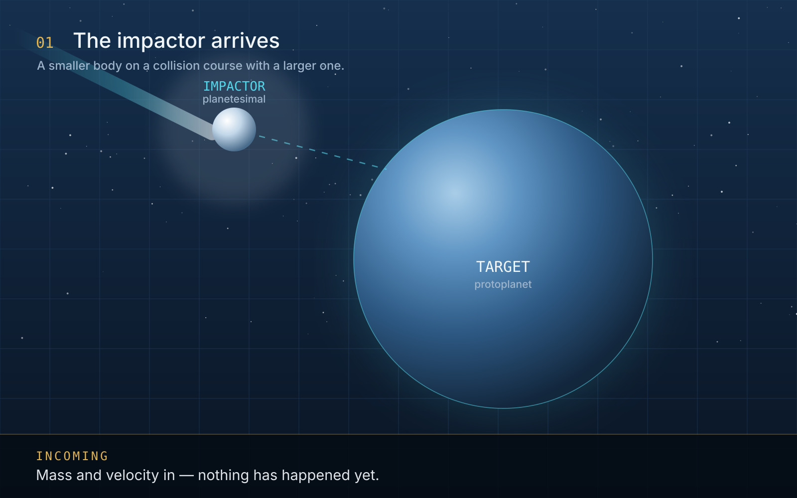
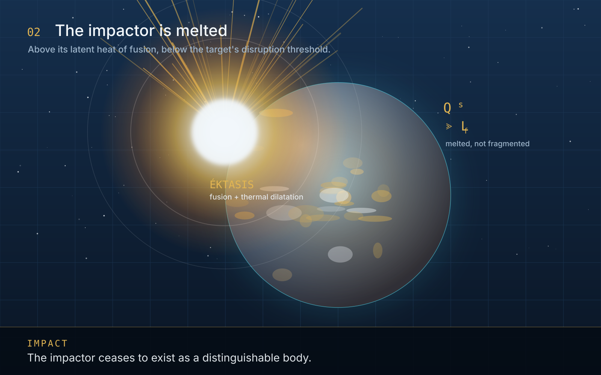
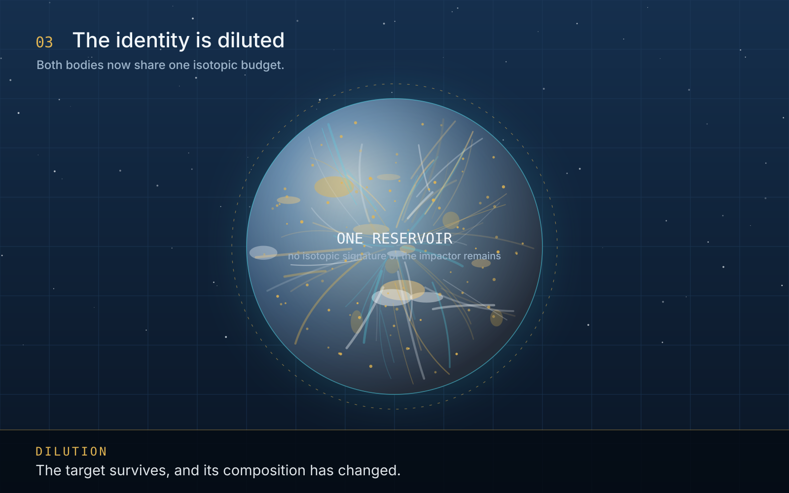

 

  
<strong>Author & Lead Researcher:</strong> 
  Francisco Javier Jiménez Gómez 
  <em>Independent Intellectual Property Owner</em>

   

  
<strong>Presented under the institutional umbrella of:</strong> 
  <strong>BRISECOM S.L.</strong> 
  <em>A specialized research and thinking laboratory dedicated to algorithmic ethics, AI governance, and human-centric technology intelligence.</em>

   
  

    30 October 2026
  

 



 

The word I am proposing in this article is **meteoectasis**, and I want to be
clear from the first line about what it is and what it is not.

It is **not** a new physical mechanism. The physics it describes is in the
literature, simulated in hydrocodes, and measured in isotopic ratios. It is a
**name for a state** — the state a body reaches when it has been hit so hard that
it stops being itself, and simultaneously not hard enough for anything to be
destroyed. The full paper is in the
[LAIA repository](https://github.com/javi-jimenez/laia/blob/main/whitepapers/meteoectasis-impact-induced-assimilation.md)
and on [laia.brisecom.org](https://laia.brisecom.org/#whitepapers).

Why bother naming something that already has a description? Because the
description is a periphrasis, and a periphrasis is where modelling errors hide.

## The gap between two words

Planetary science has good words for the extremes.

**Hit-and-run** is precise: the impactor hits, survives, and leaves. The target
takes a glancing blow and the projectile is still a projectile afterwards. **Catastrophic
disruption** is equally precise: the target is torn apart and what remains is a
family of fragments.

In between, everything is *accretion*. And accretion is a **quantity** word. It
says that mass moved from one body to another. It says nothing whatsoever about
the **state** of the material afterwards.

Consider two events that both count as accretion:

- A planetesimal hits a protoplanet, sticks, and remains a chemically distinct
  body embedded in the target's mantle.
- A planetesimal hits a protoplanet, is **entirely melted**, expands thermally,
  and flows into the target's magma ocean until nothing distinguishes its atoms
  from the target's.

In the first case the target's composition is a **sum of inherited parts**. In the
second it is a **mixture**. Both are called "accreted". For a modeller, the
difference is enormous: the first produces a body with isotopic anomalies, the
second does not.

## What the word means

**Meteoectasis** — from Greek *metéōron*, "celestial body", and *éktasis*,
"expansion, dilatation" — is the process in which an impactor is integrated into a
larger target at **intermediate energy**, with three conditions all met:

1. **The impactor is completely melted.** The energy is above its latent heat of
   fusion, not merely enough to crater the surface.
2. **The molten material expands.** This is the *éktasis*: the material loses its
   mechanical integrity and becomes part of a fluid, which is what allows it to mix
   rather than sit as an inclusion.
3. **The target survives.** Not a disruption. The event *increases* the target's
   mass and *changes* its composition.

Written as an energy window, with $Q_s$ the specific impact energy, $L_f$ the
latent heat of fusion of the impactor and $Q_D^{*}$ the disruption threshold of
the target:

$$
L_f \;\ll\; Q_s \;\lesssim\; Q_D^{*}
$$

The lower bound is what separates meteoectasis from simple accretion. The upper
bound is what separates it from fragmentation. In between is the regime where a
collision **homogenises** two bodies.

## Why the distinction earns its keep

Here is the case that motivates it. The Moon is widely believed to have formed from
the debris of a giant impact with a Mars-sized body, conventionally called Theia.
Under the standard model, a large part of the Moon derives from the **impactor**,
and the impactor's mass is diluted into the **proto-Earth**.

The problem is isotopic. Oxygen, titanium, tungsten and silicon isotope ratios in
lunar and terrestrial samples are **nearly identical**. Two bodies that formed
independently at different heliocentric distances should not be
indistinguishable — different distances mean different proportions of the
condensates available when each body accreted.

There is no shortage of proposed mechanisms: Theia formed at a similar distance;
the system re-equilibrated through a vapour-rich disc; both bodies mixed in a
common silicate reservoir; tidal processes finished the job. The mechanisms
disagree with each other.

**What they all have in common is that every one of them requires the impactor's
material to have been in a state where homogenisation is physically possible.**
Every one of them is a meteoectasis argument — they differ only on *how* the
homogenisation took place, not on whether the event was capable of producing it.

That is what a name buys you. Without it, the debate reads as a debate about
mechanism. With it, the shared premise becomes visible and the argument can be had
where it actually is.

## The defeat condition

A terminology proposal that cannot be abandoned is not a proposal, it is a
preference. So the paper states the three ways this one dies:

- **The window is empty.** If every impact energetic enough to melt the impactor
  also fragments the target, then meteoectasis never happens and the word names
  nothing. This is an empirical question about mass ratios and energy scaling, and
  it is answerable.
- **The word already exists.** If the community already uses *accretionary impact*
  or *perfect merger* with exactly this meaning, a new term fragments the
  vocabulary instead of clarifying it, and the right move is to adopt the existing
  usage.
- **The distinction predicts nothing.** If treating the impactor as a constituent
  and treating it as an inclusion give identical observable predictions for every
  quantity of interest, then the distinction is decoration. The paper claims they
  differ in isotopic budgets and in compositional stratification, and that claim
  can be checked.

None of these is a rhetorical hedge. They are the conditions under which I would
withdraw the term, and I would rather write them down now than be asked for them
later.

## What this has to do with Brisecom

This is a planetary-science paper and Brisecom is not a planetary-science
institute. The reason it exists here is the same reason the other twenty papers
exist here: **the failure mode being addressed is naming, not physics**.

A field that describes two different physical states with one word will, sooner or
later, model one as the other. I have watched this happen in software
architectures, in AI governance, in cost accounting and in defence economics —
always the same way: two distinct things get one name, and the difference
disappears from the model before anyone notices it was load-bearing.

The paper's contribution is a distinction, a window and a defeat condition. The
physics was already there. What was missing was a word for the state.
