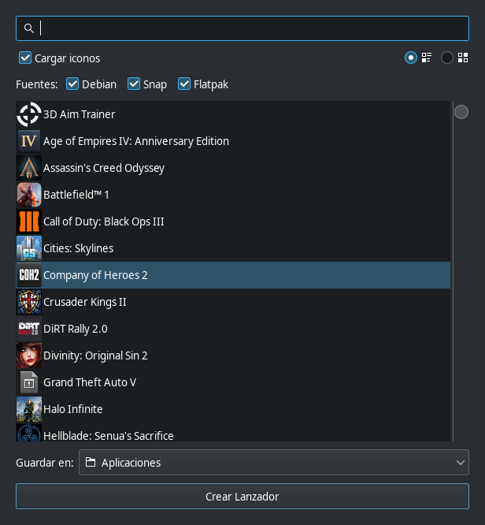

# Desktop Launcher Creator

Modern Linux desktops receive applications from at least three different worlds:
**Debian packages**, **Snap** and **Flatpak**. Each has its own idea of where the
application lives and, sometimes, whether it deserves an entry in the applications
menu. The result is a familiar annoyance: a program you have installed is there,
but you cannot find it — and there is no obvious way to create a launcher for it.

**Desktop Launcher Creator** is a small GTK application that fixes exactly that.
It scans the applications installed through Debian, Snap and Flatpak, shows them
in a simple list, and creates a `.desktop` launcher for whatever you select.

## What it does

- **Reads installed applications** from the Debian, Snap and Flatpak sources.
- **Shows them in a single list**, so you can see what is actually installed.
- **Creates a `.desktop` launcher** for the one you pick, ready to appear in your
  applications menu.

The interface is intentionally minimal: a source selector (`Debian | Snap |
Flatpak`), the list of applications, a destination and a single action button.
No configuration files to hand-edit, no guessing at `Exec=` lines.

## How it is built

The application is written in **Python 3.12** with **GTK 3** (PyGObject and
pycairo). It follows the same philosophy I keep coming back to: keep the core
logic independent from the interface, and let the interface be an adapter. In
this case the *core* is "enumerate installed applications and produce a launcher
file"; the GTK window is just one way to drive it.

It is licensed under the **GPL-3.0-or-later**.

## Getting it

Pre-built packages are attached to every release:

- **Debian/Ubuntu**: `.deb`
- **Flatpak**: `.flatpak` bundle
- **Snap**: `.snap`
- **AppImage**: portable `.AppImage`
- **Python**: wheel and source distribution (`.whl`, `.tar.gz`)

You can find them under the *Releases* section of the project:

- GitHub: <https://github.com/javi-jimenez/desktop-launcher-creator/releases>
- Gitea (self-hosted): <https://gitea.app.brisecom.net/gitea/desktop-launcher-creator/releases>

Every release is built automatically from a tagged commit, so the artifacts and
the source always match.
