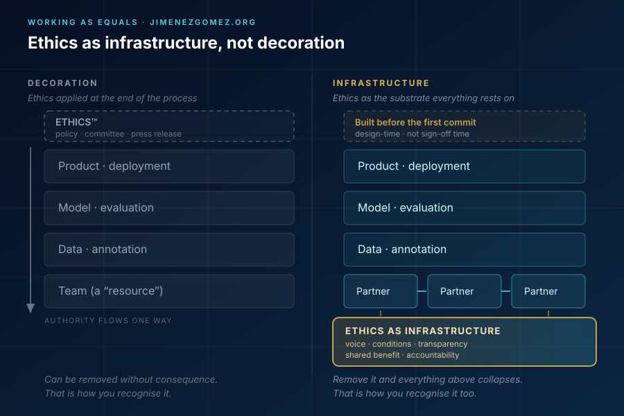

*This is not a service brochure. It is a reflection written from inside the work — from someone who builds AI systems and would like to build them from different values. The argument is deliberately structural rather than moralistic: it asks what kind of organisation produces what kind of system, and what European law already says about it.*

When we talk about "ethical AI", the debate usually stops one layer too early.

It talks about algorithmic bias, about data privacy, about hallucination rates, about copyright and training data. All of these matter. But there is a prior layer that is almost never questioned: **who builds the AI, and under what conditions?**

Most artificial intelligence systems in production today are born inside hierarchical structures in which the technical expert has been converted into a "resource" that executes what others decide. The result is a technology that reproduces the same logic as always: concentration of power, opacity, and value extraction.

Ethics cannot be a patch applied at the end of the process. It has to be **the infrastructure on which the process is built**.

## I. The problem is not the technology. It is the model.

A useful test, before any ethics committee meets: look at the last three decisions that shaped your system's architecture and ask who made them, who was consulted, and who was informed afterwards.

If the answer to the first question is always the same person, and the answer to the last two is "the people who will have to implement them", you do not have a governance problem. You have a **design** problem — and it will surface in the product, usually late and usually in production.

This is why the ethics conversation feels so often like theatre. It is being held at the wrong altitude. Discussing the fairness of a model whose requirements were dictated, unilaterally, by someone who will never see the consequences, is like discussing the diet of a person who has already been sentenced.

## II. Working as equals: neither boss, nor client, nor resource.

I have worked on projects where the "expert" was the last person to find out about the decisions. I have watched technical judgement being overruled because it did not fit the hierarchy. And I have confirmed that, when that happens, the resulting technology is more fragile, less secure and — over time — more expensive. Not metaphorically: the defects appear later, in the form of incidents and rework that nobody budgeted for.

The alternative is **working as equals**. This is not about abolishing coordination, and it is not about pretending that everyone in a project has the same role. It is about abolishing **unnecessary subordination**. The computer expert is not an executor. They are a **technical partner** who participates in defining the problem, proposes solutions, and assumes responsibility for what is built.

Note the two halves of that sentence, because they are inseparable. *Participating in defining the problem* is authority. *Assuming responsibility* is accountability. You cannot have the second without the first. An organisation that distributes accountability while withholding authority is not delegating responsibility — it is manufacturing scapegoats.

This is ethical economy applied to technology: **horizontal relationships, transparency about the conditions of the work, and respect for professional judgement.**

## III. Ethical AI is not a product. It is a way of working.

An AI system is ethical not only because its code is auditable or its data is protected. It is ethical because **the people who built it were treated ethically**.

If the team that trains the model works under precarious conditions, if the expert has no voice in the key decisions, if knowledge is extracted without recognition — the result may be technically correct, but it is **ethically hollow**. And the hollowness is not invisible. It shows up in the quality of the documentation, in the honesty of the evaluation, and in whether anyone dares to say out loud that the system is not ready.

This is where I depart from the compliance-only reading of AI ethics. A conformity checklist asks *what does the system do?* The question this article insists on is *what did building it do to the people who built it?*

The second question has no audit trail by default. You have to design one.

In this context, ethics is not a declaration of intent. It is a **daily practice**: how deadlines are negotiated, how benefits are shared, how invisible work is recognised, how disagreements are handled, and — crucially — what happens to the person who raises a problem.

That is "infrastructure" in the literal engineering sense. It is the substrate everything else rests on, and it stays invisible precisely until it fails.

## IV. Why this matters for the ethical economy.

The ethical economy is not only a set of principles about the distribution of wealth. It is also **a way of organising production**. And the production of software and AI is today one of the sectors where power is most concentrated and where the judgement of the people who actually know is least respected.

A model of working as equals in the AI field can be a **test laboratory** for that ethical economy:

- It demonstrates that you can innovate without rigid hierarchies.
- It demonstrates that the expert can be a partner and not a resource.
- It demonstrates that transparency does not slow innovation down — it makes it more solid.

The third point is the one most quickly dismissed, and the one I would defend hardest. Transparency is not a brake; it is a load-bearing wall. Every system I have seen fail badly failed first at the level of information: someone knew, and had no channel — or no reason — to say it.

## V. What European law already says, and what it does not.

If all of the above sounds like a personal preference, it is worth checking how much of it European legislators have already turned into obligations. The **EU Artificial Intelligence Act** — Regulation (EU) 2024/1689 — is usually summarised as a risk-tiering regime for products. That summary is incomplete. Read at article level, several of its provisions are about *how AI work is organised*.

| What this article argues | Where the AI Act says it |
| --- | --- |
| Ethics is a process, not a document | Art. 9(2) |
| Staff must understand the system | Art. 4 |
| Affected workers must be informed | Art. 26(7) |
| Oversight requires real authority | Art. 14 |
| Documentation and traceability | Arts. 11–12 |
| Data work has governance duties | Art. 10 |
| Rights impacts must be assessed | Art. 27 |
| Voluntary codes outside high-risk | Art. 95 |
| What happens if you ignore it | Art. 99 |

Four things follow from that table.

**First, ethics is defined as a process, not a document.** Article 9 requires risk management to be a continuous, iterative process with regular systematic review and updating. You cannot satisfy it with a PDF that nobody reads after it has been signed. This is the legal form of the argument in section I: ethics as infrastructure, not decoration.

**Second, the Act requires the human overseer to have authority.** Article 14 does not merely say that a human must be present. It says the persons assigned to oversight must have the necessary competence, training and authority, as well as the necessary support, and must be able to decide not to use the system, or to disregard, override or reverse its output. An organisation that appoints an overseer who is not allowed to stop the process has not implemented human oversight. It has implemented a signature. Anyone who has been the "expert who finds out last" will recognise the difference immediately.

**Third, the Act gives affected people a voice — but a modest one.** Article 26(7) requires employers deploying high-risk AI at the workplace to inform workers' representatives and the affected workers before putting the system into service. This is not a minor detail: employment-related AI — recruitment, task allocation, monitoring, promotion, termination — is classified as high-risk under Annex III, point 4. But note what the obligation actually is: *information*. Not negotiation, not co-determination, not a veto. European labour law has a much stronger vocabulary for that — works councils, information and consultation procedures — and the AI Act deliberately does not use it.

**Fourth, and most importantly for this article: the Act regulates systems, not working relations.** The Regulation imposes duties on *providers* and *deployers* — legal entities. It says nothing about whether the annotation team was paid a living wage, whether the engineer had a say in the architecture, whether the schedule was feasible, or whether the person who flagged the risk kept their job. Article 4 touches on staff, but as a matter of competence, not of dignity.

Part of that gap is filled by adjacent instruments: the **Directive (EU) 2024/2831 on platform work** (algorithmic management, human oversight of automated decisions, information and consultation of workers' representatives), **Article 22 GDPR** (the right not to be subject to a solely automated decision producing legal or similarly significant effects), and the **European Pillar of Social Rights**. Part of it is filled by the **Council of Europe Framework Convention on AI**, the first binding international treaty in this field, and by the **ILO Declaration on Fundamental Principles and Rights at Work**, which since 2022 counts a safe and healthy working environment among those fundamental principles.

But no instrument yet says what this article says: that **an AI system cannot be considered ethical if the conditions under which it was built were not**. That is not a gap that a better-drafted article could close. It is a question about who gets to design the organisation that designs the system. Law can make the question visible. It cannot answer it for us.

A note on timing for readers who need to act: the Regulation entered into force on 1 August 2024; the prohibitions have applied since 2 February 2025; obligations for general-purpose AI models since 2 August 2025; and high-risk obligations for Annex III systems since 2 August 2026 — with Annex I systems following on 2 August 2027 (Article 113). The Commission proposed in late 2025 to defer parts of the high-risk timetable, so anyone building a compliance plan should verify the current state of that file before relying on the dates above.

### The full argument, as a whitepaper

The article-level reading above, the five structural conditions and a proposed disclosure instrument are developed formally in a whitepaper published in the LAIA series:

**→ [Ethics as Infrastructure: Build Conditions and the Layer the EU AI Act Does Not Regulate](https://github.com/javi-jimenez/laia/blob/main/whitepapers/ethics-as-infrastructure-build-conditions.md)** — LAIA Whitepaper #13, October 2026 *(CC BY-NC-SA 4.0)* · [PDF](https://github.com/javi-jimenez/laia/releases/latest/download/ethics-as-infrastructure-build-conditions.pdf)

It adds three things this post does not attempt: a condition-by-condition legal coverage table, a specification of the **Build-Conditions Disclosure** (eight auditable items with evidence requirements and three integration paths into Articles 27, 95 and ISO/IEC 42001), and an explicit account of how such an instrument fails — self-reporting bias, gaming by aggregation, and weaponisation against individuals.

## VI. Conclusion.

I do not know whether ethical AI will save the world. But I do know that **the way we build it matters as much as what we build**.

And I know something else: ethics that exists only in a document, a committee or a press release is not ethics. It is decoration. Decoration can be removed without consequence — which is precisely how you recognise it.

Working as equals, with transparency and respect for technical judgement, is not a utopia. It is a decision. And that decision, applied to technology, is also a way of doing the ethical economy — the only kind that survives contact with a deadline.

---

## Bibliography

What follows is not a list of authorities invoked to close the argument. Each entry carries a note on what it actually contributes to the text above — and, where relevant, where I think it falls short of it.

### Primary reference

**Jiménez Gómez, F. J. (2026). "Ethics as Infrastructure: Build Conditions and the Layer the EU AI Act Does Not Regulate."** LAIA Whitepaper #13, Brisecom / LAIA Project. <https://github.com/javi-jimenez/laia/blob/main/whitepapers/ethics-as-infrastructure-build-conditions.md>

> *Contribution:* the formal version of this article's argument, and the source of the five conditions, the coverage table and the Build-Conditions Disclosure. Cited first because it is the citable reference: the blog post is the readable entry point, the whitepaper is the version meant to be quoted, reviewed and improved.

### Hard law

**Regulation (EU) 2024/1689 of the European Parliament and of the Council laying down harmonised rules on artificial intelligence (Artificial Intelligence Act)**, OJ L, 12 July 2024. <https://eur-lex.europa.eu/eli/reg/2024/1689/oj>

> *Contribution:* the legal spine of section V. Articles 4, 9, 10, 14, 26(7), 27 and 99 are the closest thing existing law offers to the article's thesis — ethics as a continuous process, oversight with real authority, and information rights for affected workers. *Its limit, argued in section V:* it regulates providers and deployers as legal entities, never the internal working relations of the organisations that build systems.

**Directive (EU) 2024/2831 on improving working conditions in platform work**, OJ L, 2024/2831, 23 October 2024. <https://eur-lex.europa.eu/eli/dir/2024/2831/oj>

> *Contribution:* the one EU instrument that regulates *algorithmic management* as a labour question rather than a product-safety question — transparency of automated systems, human oversight of automated decisions, and information and consultation of workers' representatives. It shows that the "working as equals" argument is not merely aspirational; it has begun to be legislated, just not yet inside AI-producing organisations.

**Regulation (EU) 2016/679 (General Data Protection Regulation)**, OJ L 119, 4 May 2016, in particular Article 22 and Recitals 60 and 71. <https://eur-lex.europa.eu/eli/reg/2016/679/oj>

> *Contribution:* supplies the individual right that the AI Act does not grant — not to be subject to a decision based solely on automated processing that produces legal or similarly significant effects. Useful as a boundary marker: European law protects the *data subject* before the algorithm, but has no equivalent provision protecting the *person who built* the algorithm.

**Council of Europe Framework Convention on Artificial Intelligence and Human Rights, Democracy and the Rule of Law**, CETS No. 225, opened for signature 5 September 2024. <https://www.coe.int/en/web/artificial-intelligence/the-framework-convention-on-artificial-intelligence>

> *Contribution:* the first binding international treaty on AI, and the reason the article can speak of obligations rather than recommendations. It frames the problem in terms of human rights, democracy and the rule of law — a vocabulary in which "the expert had no voice" is not a management preference but a governance failure.

**International Labour Organization, Declaration on Fundamental Principles and Rights at Work**, 1998, as amended in 2022. <https://www.ilo.org/declaration>

> *Contribution:* grounds the "conditions under which AI is built" argument in obligations that predate AI by decades. The 2022 amendment added a safe and healthy working environment as a fifth fundamental principle — a useful reminder that the newest technology does not suspend the oldest commitments.

**European Pillar of Social Rights**, proclaimed by the European Parliament, the Council and the Commission, OJ C 428, 13 December 2017.

> *Contribution:* provides the "ethical economy" frame invoked in section IV — fair working conditions, information and consultation, fair wages — as declared EU policy rather than personal opinion. Its weakness is the one this article attacks: the Pillar is largely programmatic, and its principles have no direct effect in most national systems.

### Principles and soft law

**OECD, Recommendation of the Council on Artificial Intelligence**, OECD/LEGAL/0449, 2019, amended 2024. <https://legalinstruments.oecd.org/en/instruments/OECD-LEGAL-0449>

> *Contribution:* the accountability principle — AI actors should be accountable for the proper functioning of AI systems "based on their roles, the context, and consistent with the state of the art". That formulation is the hinge of section II: accountability is role-relative, which is exactly why authority and responsibility cannot be separated.

**UNESCO, Recommendation on the Ethics of Artificial Intelligence**, adopted 23 November 2021. <https://unesdoc.unesco.org/ark:/48223/pf0000381137>

> *Contribution:* the strongest intergovernmental statement that AI ethics includes *labour* — its policy area on economy and labour calls for decent work, fair transition and protection of workers' rights. Cited here because it is the document that most clearly refuses to treat ethics as a matter of model behaviour alone.

**National Institute of Standards and Technology, Artificial Intelligence Risk Management Framework (AI RMF 1.0)**, NIST AI 100-1, January 2023. <https://doi.org/10.6028/NIST.AI.100-1>

> *Contribution:* supplies the operational vocabulary — a GOVERN function that sits above mapping, measuring and managing risk — that makes "ethics as infrastructure" auditable rather than rhetorical. It is voluntary and deliberately process-oriented, which is both its strength and the reason it cannot substitute for binding duties.

### Critique and design theory

**Wagner, B. (2018). "Ethics as an Escape from Regulation: From 'Ethics-Washing' to Ethics-Shopping?"**, in *Being Profiled: Cogitas Ergo Sum*, edited by E. Bayamlıoğlu et al., Amsterdam University Press.

> *Contribution:* names the phenomenon this article calls decoration, and gives the argument its title. Wagner's point is sharper than mine: voluntary ethics discourse can function as a *substitute* for regulation, not a complement to it. Every claim in section III that ethics is a daily practice should be read against his warning.

**Friedman, B. & Hendry, D. G. (2019). *Value Sensitive Design: Shaping Technology with Moral Imagination*.** MIT Press. <https://mitpress.mit.edu/9780262039536/>

> *Contribution:* the methodological answer to "ethics cannot be a patch". Value Sensitive Design argues that values must be enrolled at design time and traced through the whole process, because by the time a system exists its moral shape is largely fixed. This is where "infrastructure" stops being a metaphor and becomes a design method.

**Shneiderman, B. (2022). *Human-Centered AI*.** Oxford University Press.

> *Contribution:* provides the conceptual pairing — high automation *and* high human control — that section V finds reflected in Article 14. Shneiderman's "two-dimensional" model is useful precisely because it refuses the false choice between automation and oversight, and insists that human control must be designed as a capability, not an approval step.

**Crawford, K. (2021). *Atlas of AI: Power, Politics, and the Planetary Costs of Artificial Intelligence*.** Yale University Press.

> *Contribution:* the empirical basis for the opening claim of section I — that the technology reproduces old logics of concentration and extraction. Crawford's account of AI as an extractive industry (of minerals, data and labour) is the clearest available demonstration that "the model" is an organisational and political artefact, not a neutral one.

**Roberts, S. T. (2019). *Behind the Screen: Content Moderation in the Shadows of Digital Labour*.** Yale University Press.

> *Contribution:* documents the invisible workforce without which most commercial AI is impossible, and does so with enough ethnographic detail to make section III concrete rather than abstract. When I write that the hollowness of an unethical process shows up in the product, this is the book I am thinking of.

**Gray, M. L. & Suri, S. (2019). *Ghost Work: How to Stop Silicon Valley from Building a New Global Underclass*.** Houghton Mifflin Harcourt.

> *Contribution:* explains why the working conditions behind AI are structurally invisible — the labour is deliberately designed to be unassignable to a named person. Read together with Roberts, it turns "if the team works under precarious conditions" from a hypothetical into a description.
